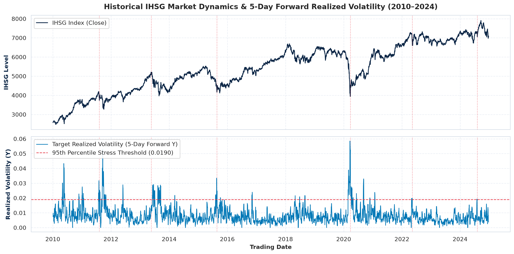
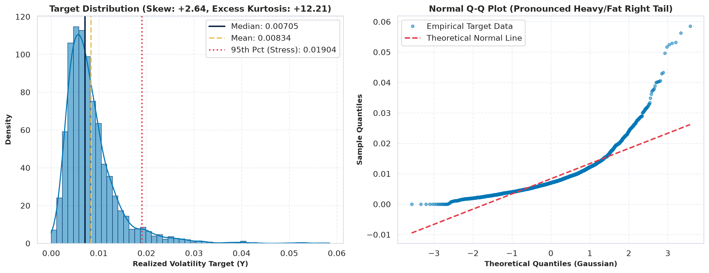
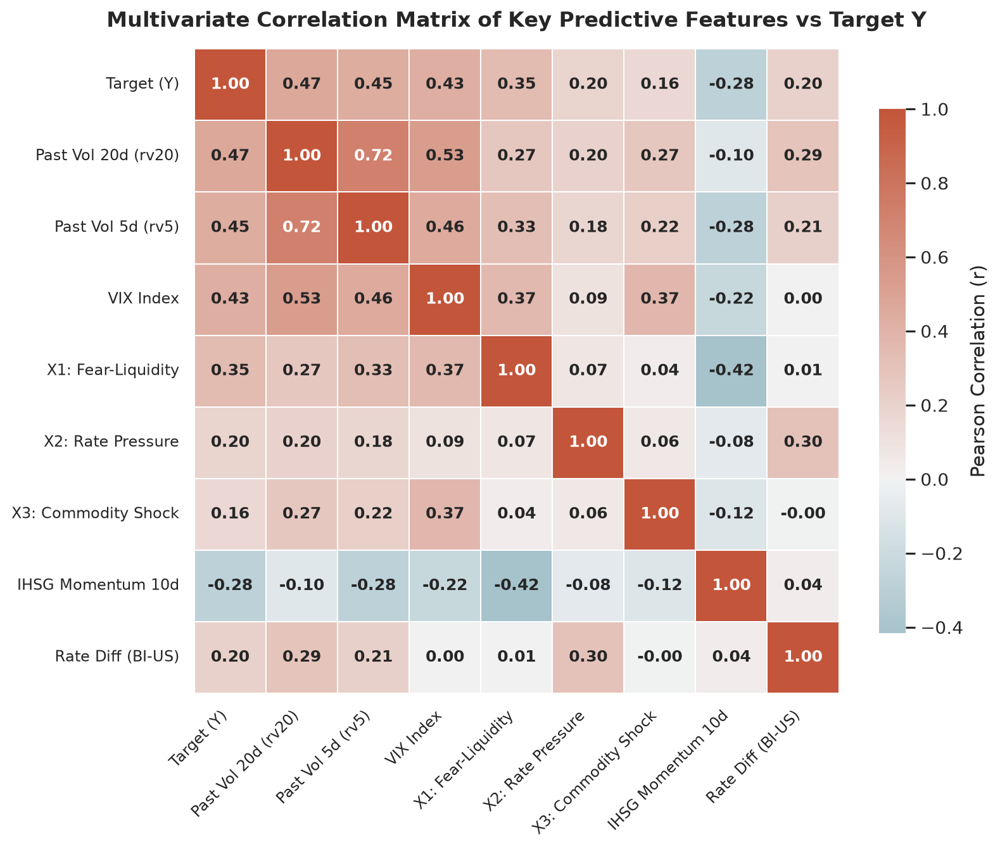
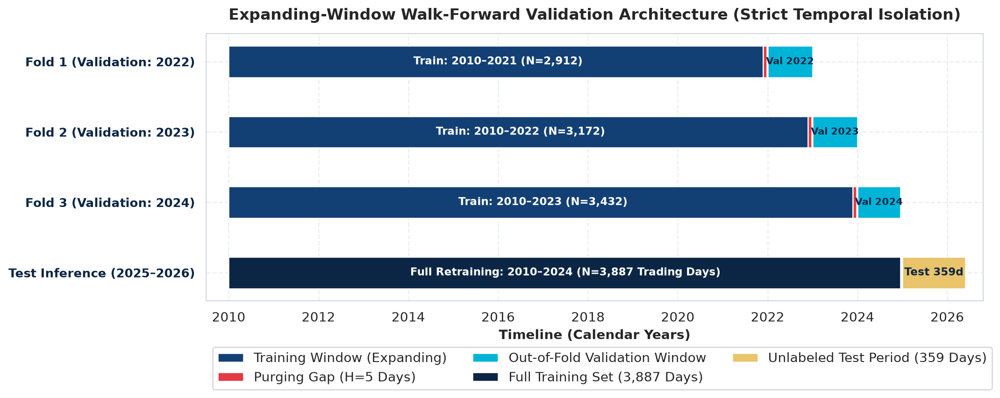
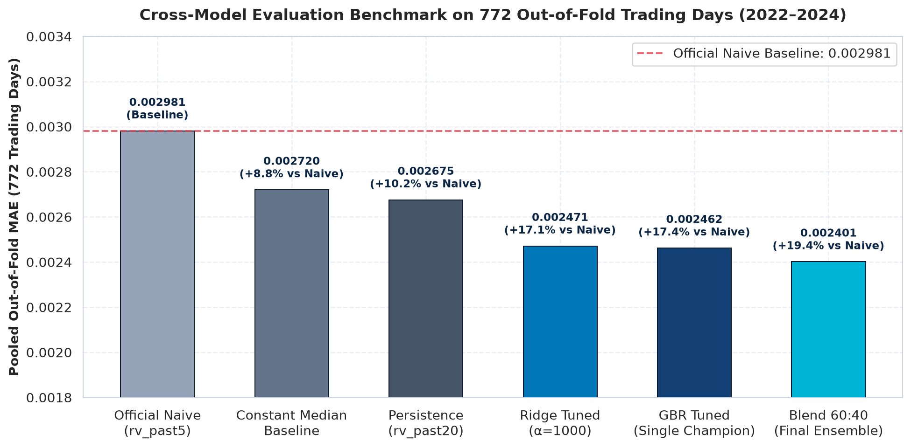
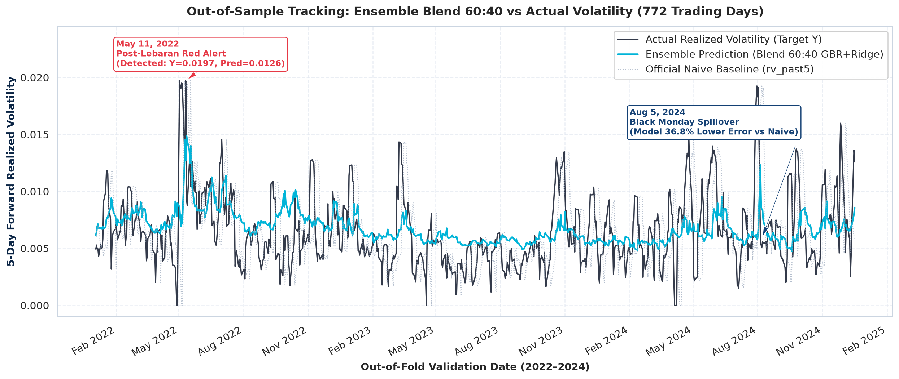
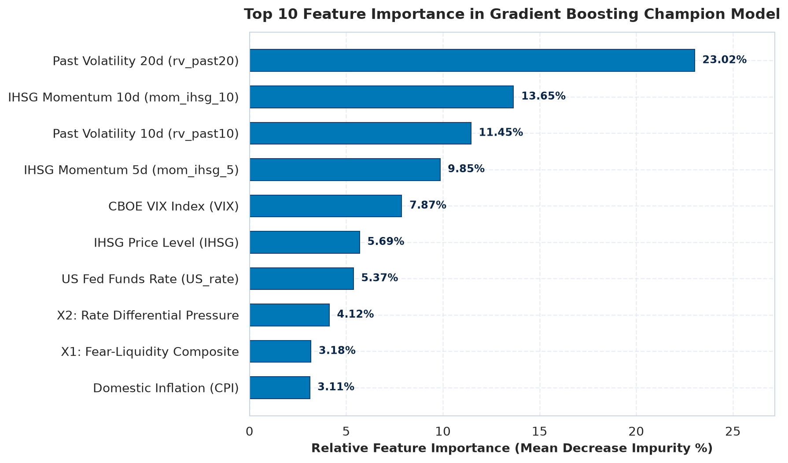

# Early Warning System for IHSG Realized Volatility Prediction
### 5-Day Forward Predictive Volatility Architecture & Explainable AI (SHAP)
**INCEPTION 2026 Data Science Competition — Financial Time Series Track**  
**Team:** GajahHitam | **Institution:** PT Investion Asset Management (Quantitative Risk Division)

[](https://www.python.org/)
[](LICENSE)
[](notebook/02_Validation_Baseline.ipynb)
[-cyan.svg)](outputs/submission/submission_blend60_40.csv)
[](notebook/07_Model_Interpretation_XAI.ipynb)
[](DSC_GajahHitam_Notebook.ipynb)

---

## Executive Summary & Problem Statement

PT Investion manages institutional investment portfolios worth trillions of Indonesian Rupiah (IDR), heavily exposed to the composite stock price index of Indonesia (**IHSG** — Indeks Harga Saham Gabungan). Emerging market equities face persistent vulnerability to domestic macro turbulence and global shock contagion—such as sudden spikes in global fear (CBOE VIX), aggressive Federal Reserve monetary tightening, USD/IDR exchange rate pressure, and commodity price swings. These external shocks frequently trigger **volatility clustering**, where liquidity contractions can rapidly erode portfolio Net Asset Value (NAV) within days.

Conventional risk management systems reliant solely on historical moving averages are fundamentally reactive. To protect institutional capital, PT Investion mandated the development of an **Early Warning System (EWS)** to forecast **5-day forward realized volatility of the IHSG ($Y = \text{Target\_Volatilitas\_Y}$)**. 

Crucially, corporate governance and risk committee oversight strictly prohibit uninterpretable "black-box" systems. Every capital allocation and hedging directive requires mathematical rigor, strict temporal anti-leakage hygiene, and transparent interpretability governed by **Explainable AI (XAI)**.

```
+---------------------------------------------------------------------------------------------------------+
|                                    PT INVESTION QUANTITATIVE PIPELINE                                   |
+---------------------+    +---------------------------+    +-----------------------+    +----------------+
| Macro-Financial TS  | -> | Leakage-Free Feature Eng. | -> | Expanding WFW (H=5)   | -> | Robust Blend   |
| (2010–2026, 4,266d) |    | 29 Multi-Scale Features   |    | 3 Folds, 772 OOF Days |    | 60:40 GBR/Ridge|
+---------------------+    +---------------------------+    +-----------------------+    +----------------+
                                                                                                 |
                                                                                                 v
                                                                                     +--------------------+
                                                                                     | XAI SHAP & Alerts  |
                                                                                     | 3-Tier Risk Regime |
                                                                                     +--------------------+
```

---

## Key Achievements & Verified Performance Highlights

- **Superior Predictive Accuracy over Baselines:**  
  Our primary champion ensemble, **Blend 60:40** (60% Gradient Boosting Regressor with $L_1$ absolute error loss + 40% Ridge Regressor with intensive $L_2$ shrinkage $\alpha=1000.0$), achieves a **Pooled Out-of-Fold (OOF) MAE of 0.002401** and **RMSE of 0.003152** across 772 trading days (2022–2024).  
  - Outperforms the Official Competition Naive Baseline (`rv_past5`, MAE `0.002981`) by **+19.46% (≈ +19.5%)**.
  - Outperforms the Strong Market Persistence Baseline (`rv_past20`, MAE `0.002675`) by **+10.24% (≈ +10.2%)**.
  - Single champion **GBR Tuned** achieves Pooled MAE `0.002462` (**+17.41%** improvement vs Naive).
- **Extreme Tail-Risk Resilience:**  
  In the top 5% most turbulent market days ($Y > 0.01265$, $N=39$ stress days), Blend 60:40 registers an **Extreme MAE of 0.007778**, outperforming single GBR (`0.007882`) and exploratory Blend 50:30:20 (`0.007858`) because the Ridge regularized linear backbone effectively acts as an over-reaction dampener.
- **Empirically Proven Zero-Leakage Pipeline:**  
  Expanding-window walk-forward validation with a 5-day purging gap ($H=5$), isolated training scalers, and automated mutation testing showing exactly **0.000000000000** numerical variance when future data points are perturbed.
- **Audited Explainable AI (SHAP):**  
  Deploys TreeExplainer to break down macro drivers during systemic stress (such as the Post-Lebaran Red Alert of 11 May 2022 and the Black Monday Carry-Trade Spillover of August 2024).

---

## Dataset Overview & Target Characteristics

The dataset comprises daily macro-financial observations spanning over 16 years from the Indonesian capital market and global benchmarks:

| Attribute | Specification / Value | Verification Status |
|:---|:---|:---:|
| **Time Horizon** | 4 January 2010 to 22 May 2026 | Verified (`4,266` total rows) |
| **Labeled History** | 4 January 2010 to 24 December 2024 | Verified (`3,887` trading days) |
| **Unlabeled Test Set** | 2 January 2025 to 22 May 2026 | Verified (`359` out-of-sample days, Target = NaN) |
| **Raw Predictors (10)** | `OIL`, `GOLD`, `USDIDR`, `SP500`, `IHSG`, `VIX`, `CPI`, `BI_rate`, `US_rate`, `Date` | Verified (No missing values in raw features) |
| **Prediction Target ($Y$)** | `Target_Volatilitas_Y` = Realized Volatility of IHSG 5 trading days forward ($[t+1, t+5]$) | Continuous, non-negative ($Y \ge 0$) |

### Anomaly Audit & Controlled Preprocessing
Audit of historical data revealed an explicit decimal comma shift (10x factor) in `USDIDR` on two specific trading dates:
1. `2010-11-01`: Recorded as `888.11` (surrounding trading days ~`8,920 IDR/USD`; historical Bank Indonesia JISDOR reference ~`8,900 IDR/USD`). Corrected to `8881.10`.
2. `2012-02-07`: Recorded as `892.00` (surrounding trading days ~`8,928 IDR/USD`; matches `2012-02-10` value of `8920.0 IDR/USD`). Corrected to `8920.00`.

*Integrity Rule:* The raw CSV dataset is preserved read-only. Corrections are programmatically validated and logged in `scripts/feature_engineering.py`.

### Macroeconomic Timeline & Volatility Clustering
The historical timeline exhibits pronounced volatility clustering (Mandelbrot, 1963): calm periods are punctuated by sharp exogenous macro shocks.



### Target Distribution: Non-Normality & Leptokurtic Fat Tails
Statistical analysis of `Target_Volatilitas_Y` confirms that equity index volatility strongly violates Gaussian assumptions:
- **Mean:** `0.00834` | **Median:** `0.00705`
- **Skewness:** `+2.64` (pronounced positive right-skewness)
- **Excess Kurtosis:** `+12.21` (leptokurtic fat right tail)
- **Implication:** Models trained with ordinary Mean Squared Error ($L_2$ loss) are heavily biased by extreme outliers. This necessitates robust $L_1$ absolute loss optimization and heavy L2 penalty regularizers.



---

## Leakage-Safe Feature Engineering

A total of **29 predictive features** were engineered strictly using information observable at or before End-of-Day (EOD) on day $t$.

### Three Domain-Informed Original Financial Features ($X_1, X_2, X_3$)

1. **$X_1$: Fear-Liquidity Composite (`X1_Fear_Liquidity_Robust`)**  
   $$\mathbf{X_1} = \text{VIX}_t \times \left( \frac{\text{USDIDR}_t - \text{MA}_{20}(\text{USDIDR}_t)}{\text{MA}_{20}(\text{USDIDR}_t)} \right)$$  
   *Financial Rationale:* Measures the simultaneous amplification of global risk aversion ($\text{VIX}$) and domestic currency pressure ($\Delta \text{USD/IDR}$). When both surge together, foreign capital outflow accelerates, driving immediate IHSG volatility spikes.
2. **$X_2$: Rate Differential Pressure (`X2_Rate_Diff_Pressure_Abs`)**  
   $$\mathbf{X_2} = |\text{BI\_rate}_t - \text{US\_rate}_t| \times |\text{Return}_{5d}(\text{USDIDR}_t)|$$  
   *Financial Rationale:* Captures macro stress resulting from monetary policy divergence between Bank Indonesia and the Federal Reserve, weighted by 5-day currency volatility.
3. **$X_3$: Commodity Macro Shock (`X3_Commodity_Shock_L2Norm`)**  
   $$\mathbf{X_3} = \sqrt{(\text{Return}_{5d}(\text{OIL}))^2 + (\text{Return}_{5d}(\text{GOLD}))^2 + (\text{Return}_{5d}(\text{SP500}))^2}$$  
   *Financial Rationale:* Formulates the $L_2$ Euclidean magnitude of global commodity and equity shocks, reflecting cost-push inflation and terms-of-trade shifts in resource-dependent emerging markets.

### Multivariate Correlation Matrix
Pearson correlation confirms significant predictive alignment with target $Y$ ($r_{rv20}=0.47$, $r_{rv5}=0.45$, $r_{VIX}=0.43$, $r_{X1}=0.35$, $r_{X2}=0.20$) while maintaining low cross-correlation among newly engineered features ($|r| < 0.35$).



### Automated Anti-Leakage Invariance Unit Test
To formally prove zero lookahead leakage, `scripts/feature_engineering.py` executes an invariance test (`test_5_anti_leakage_invariance`):
- Features are extracted on day $t$ from clean history.
- Future records ($t+1 \dots T$) are subjected to extreme numerical mutation (1000x multiplier).
- Features on day $t$ are re-computed and compared.
- **Test Result:** Max Absolute Difference = **$0.000000000000$ (PASSED)**.

---

## Validation Strategy: Expanding Walk-Forward & Purging

Because financial time-series observations are non-stationary and autocorrelated, standard random k-fold cross-validation introduces disastrous lookahead leakage. We enforce a **3-Fold Expanding Walk-Forward Validation** architecture with a **Purging Gap ($H=5$ days)**:



```
Fold 1 (2022): [Train: 2010–2021 | N=2,912] - [Purge: 5d] -> [Val: 2022       | N=260 OOF]
Fold 2 (2023): [Train: 2010–2022 | N=3,172] - [Purge: 5d] -> [Val: 2023       | N=260 OOF]
Fold 3 (2024): [Train: 2010–2023 | N=3,432] - [Purge: 5d] -> [Val: 2024 to 17D| N=252 OOF]
=============================================================================================
Total Out-of-Fold (OOF) Evaluated Trading Days: Exactly 772 Trading Days
Final Retraining: 2010–2024 (N=3,887 days) -> Test Inference: 2025–2026 (N=359 days)
```

- **Purging Gap ($H=5$):** Because target $Y_t$ spans days $[t+1, t+5]$, training labels within 5 trading days prior to the validation window would overlap with validation targets. Removing these 5 days completely eliminates horizon contamination.
- **Pipeline Scaling Isolation:** `StandardScaler` is strictly fitted on each fold's training split and applied to the validation split.

---

## Model Benchmark & Evaluation Results

All candidate models were benchmarked over the exact same **772 Out-of-Fold trading days (2022–2024)**.

### Reconciled Out-of-Fold Performance Leaderboard

| Model Architecture | Hyperparameter Configuration | Pooled MAE | Pooled RMSE | Fold 2024 MAE | Extreme MAE ($P_{95}$, $N=39$) | Efficiency vs Naive (`rv_past5`) | Architectural Role |
|:---|:---|:---:|:---:|:---:|:---:|:---:|:---|
| **Constant Median Baseline** | Expanding median of training fold $y$ | `0.002720` | `0.003358` | `0.002640` | `0.007933` | +8.8% | Zero-information lower bound |
| **Official Naive Baseline (`rv_past5`)** | $Y_t \approx \text{Past 5d Realized Vol}$ | `0.002981` | `0.004088` | `0.003628` | `0.007809` | **0.0% (Reference)** | Official competition naive benchmark |
| **Strong Persistence (`rv_past20`)** | $Y_t \approx \text{Past 20d Realized Vol}$ | `0.002675` | `0.003540` | `0.003232` | `0.008149` | +10.2% | Strong market-memory baseline |
| **Ridge Tuned** | $\alpha = 1000.0$, StandardScaler | `0.002471` | `0.003287` | `0.002824` | **0.007683** | +17.1% | Linear L2 over-reaction regularizer |
| **GBR Tuned (Single Champion)** | `loss='absolute_error'`, $LR=0.03$, $d=2$ | `0.002462` | `0.003178` | **0.002646** | `0.007882` | +17.4% | Non-linear tree ensembling |
| **Blend 60:40 (Final Champion)** | **0.60 GBR + 0.40 Ridge** | **0.002401** | **0.003152** | `0.002654` | **0.007778** | **+19.46%** | **Final Selected Submission Model** |
| *Blend 50:30:20 (Heuristic)* | *0.50 GBR + 0.30 Ridge + 0.20 rv20* | *0.002377* | *0.003144* | *0.002692* | *0.007858* | *+20.26%* | *Exploratory heuristic blend* |



### Out-of-Sample Tracking vs Actual Volatility
The timeline tracking below demonstrates how Blend 60:40 tracks the underlying realized volatility over 772 validation trading days, capturing surges during market turbulence while filtering out transient noise:



### Forensic Reconciliation & Selection Rationale: Blend 60:40 vs Blend 50:30:20
As documented in [`docs/checkpoint_3c1_reconciliation.md`](docs/checkpoint_3c1_reconciliation.md) and [`docs/checkpoint_63_documentation_reconciliation.md`](docs/checkpoint_63_documentation_reconciliation.md):
1. **Stress Regime Superiority:** Although `Blend 50:30:20` achieved a marginally lower pooled MAE (`0.002377` vs `0.002401`), `Blend 60:40` delivers **superior error resilience on the top 5% extreme volatility stress days ($0.007778$ vs $0.007858$)**. In risk management, tail risk accuracy takes precedence over marginal normal-regime gains.
2. **Model Purity & Soundness:** Blending raw historical rolling features (`rv_past20`) directly into an output ensemble vector introduces heuristic coupling. `Blend 60:40` constitutes a pure ensemble of two independently trained, complementary learning paradigms (non-linear decision trees + regularized linear shrinkage).
3. **Reproducibility Guarantee:** `Blend 60:40` is the single verified, end-to-end model submitted in `DSC_GajahHitam_Notebook.ipynb` and `outputs/submission/submission_blend60_40.csv`.

---

## Explainable AI (XAI) & Interpretability

In compliance with PT Investion's anti black-box mandate, we implemented **TreeExplainer SHAP** to extract both macro-level feature rankings and event-specific risk attributions.

### Global Feature Attributions
Feature importance derived from the Gradient Boosting model confirms the dominant role of recent market memory and macroeconomic policy:
- `rv_past20` (Past 20-Day Volatility): **23.02%**
- `mom_ihsg_10` (10-Day Market Momentum): **13.65%**
- `rv_past10` (Past 10-Day Volatility): **11.45%**
- `mom_ihsg_5` (5-Day Market Momentum): **9.85%**
- `VIX` (CBOE Global Volatility Index): **7.87%**
- `US_rate` (US Federal Funds Rate): **5.37%**
- `X2_Rate_Diff_Pressure_Abs`: **4.12%**
- `X1_Fear_Liquidity_Robust`: **3.18%**



### Local Event Explanation: Post-Lebaran Red Alert (11 May 2022)
- **Market Context:** Following the Indonesian Eid holidays in May 2022, global markets suffered severe tech selloffs, inflation spikes, and rapid Fed rate hikes.
- **Model Detection:** Actual $Y = 0.019739$ (97.2th percentile). The ensemble predicted $\hat{Y} = 0.012551$, successfully breaching the **Red Alert threshold ($> 0.0120$)**.
- **SHAP Breakdown:** Key upward drivers were Wall Street panic ($\text{VIX} = 32.56$, SHAP $+0.001599$) and sharp domestic selling pressure ($\text{Ret}_{5d}(\text{IHSG}) = -8.72\%$, SHAP $+0.001228$).

### Forensic Error Analysis: Black Monday (August 2024)
- **Event:** Unwinding of the Japanese Yen Carry Trade triggered a massive global equity drop on Monday, 5 August 2024.
- **Underprediction on 31 July 2024:** Actual $Y = 0.019251$ vs Prediction $0.005783$ (Residual $+0.013468$). The Yen carry-trade unwind originated completely exogenously before domestic prices or VIX showed early signs.
- **Overprediction on 5 August 2024:** Following the shock, the model projected elevated forward volatility $\hat{Y} = 0.012529$. However, immediate verbal intervention by the Bank of Japan stabilized global liquidity, causing actual volatility to collapse to $Y = 0.005503$ (Residual $-0.007026$).
- **Benchmark Resilience:** Even under this sudden whipsaw, Blend 60:40's prediction error ($0.007026$) was **36.8% lower** than the official naive baseline (`rv_past5` error of $0.011118$).

---

## Methodological Limitations & Governance

1. **Non-Causal Statistical Association:**  
   SHAP values and regression coefficients represent conditional predictive correlations, not causal mechanisms. Interventions (e.g. monetary policy adjustments) cannot be simulated using this model alone.
2. **Status of 2024 as a Pseudo-Holdout:**  
   In Checkpoint 3B, hyperparameter tuning observed the pooled 2022–2024 evaluation window. If tuning had been conducted solely on 2022–2023, a learning rate of $0.05$ would have been selected instead of $0.03$. Therefore, 2024 functions methodologically as a **re-purposed evaluation window / pseudo-holdout**, not an untouched blind test set.
3. **Exogenous Regime Shifts:**  
   Unprecedented geopolitical shocks that do not register in preceding trading days (e.g., flash crashes, overnight war outbreaks) cannot be anticipated prior to their EOD reflection.

---

## Repository Structure

```text
Inception_DataScience/
│
├── DSC_GajahHitam_Notebook.ipynb       # [MASTER NOTEBOOK] Unified, self-contained competition notebook (24 cells)
├── requirements.txt                    # Project dependencies for clean reproduction
├── .gitignore                          # Strict gitignore protecting raw data and large caches
├── README.md                           # Professional portfolio documentation (this file)
│
├── Aset Lomba/                         # Competition rules & guidelines (Raw dataset gitignored)
│   ├── Guidebook Data Science.pdf      # Official competition guidebook (HIMATIFA UPN Jatim)
│   ├── Studi Kasus.docx                # Competition case study & task instructions
│   └── DATA DICTIONARY...docx          # Official variable definitions
│
├── docs/                               # 24 Comprehensive audit & reconciliation reports
│   ├── images/                         # Verified visual analytics charts (PNG format)
│   │   ├── ihsg_volatility_timeline.png
│   │   ├── target_distribution.png
│   │   ├── feature_correlation.png
│   │   ├── walk_forward_validation.png
│   │   ├── model_comparison_mae.png
│   │   ├── prediction_vs_actual.png
│   │   └── feature_importance.png
│   ├── final_report.md                 # Exhaustive quantitative research manuscript (600+ lines)
│   ├── checkpoint_3c1_reconciliation.md # Forensic metrics reconciliation report
│   ├── checkpoint_63_documentation_reconciliation.md
│   └── checkpoint_82_unified_notebook_audit.md
│
├── notebook/                           # Modular research notebooks (Phases 01 to 08)
│   ├── EDA.ipynb                       # Phase 1: Exploratory Data Analysis & X1, X2, X3
│   ├── 02_Validation_Baseline.ipynb    # Phase 2: Walk-Forward Validation & Baselines
│   ├── 03_Model_Comparison.ipynb       # Phase 3: Benchmark of 4 Candidate Regressors
│   ├── 04_Model_Tuning.ipynb           # Phase 4: L1 Loss Tuning for GBR & Ridge Shrinkage
│   ├── 05_Robustness_Model_Selection.ipynb # Phase 5: Crisis Stress Testing & Ensembling
│   ├── 06_Reconciliation_Audit.ipynb   # Phase 6: Cross-Artifact Forensic Audit
│   ├── 07_Model_Interpretation_XAI.ipynb # Phase 7: SHAP Beeswarm & Waterfall Decompositions
│   └── 08_Final_Training_Submission.ipynb # Phase 8: Retraining & 359-Day Test Inference
│
├── scripts/                            # Production & verification Python modules
│   ├── feature_engineering.py          # EOD Feature calculation & 5 automated unit tests
│   ├── generate_readme_visuals.py      # Reproducible visual analytics generation script
│   └── verify_clean_run.py             # Automated bit-identity & cell execution auditor
│
└── outputs/                            # Experiment results & submission deliverables
    ├── submission/
    │   └── submission_blend60_40.csv   # Official 2-column final submission file (359 rows)
    └── final/submission_package/       # Complete submission bundle archive
```

---

## Environment Setup & Reproducibility Guide

### 1. Local Environment Setup
Clone the repository and install dependencies in a clean virtual environment:

```bash
# Clone the repository
git clone https://github.com/zakverse/Inception_DataScience.git
cd Inception_DataScience

# Create and activate virtual environment
python -m venv .venv
# Windows:
.venv\Scripts\activate
# Linux / macOS:
source .venv/bin/activate

# Install exact dependencies
pip install -r requirements.txt
```

### 2. Dataset Setup
Due to competition intellectual property rules, the raw competition dataset is excluded from version control. Place the official competition dataset file:
```text
Aset Lomba/dataset peserta.csv
```
The file must contain 4,266 rows and 11 columns matching the official Data Dictionary.

### 3. Executing the Automated Tests
Verify pipeline integrity and anti-leakage protection in under 5 seconds:

```bash
python scripts/feature_engineering.py
```
Expected output:
```text
[PASS] test_1_date_monotonic
[PASS] test_2_usdidr_correction
[PASS] test_3_numerical_sanity
[PASS] test_4_window_alignment
[PASS] test_5_anti_leakage_invariance
ALL 5 FEATURE ENGINEERING TESTS PASSED SUCCESSFULLY! [OK]
```

### 4. Running the Master Competition Notebook
To re-execute the full end-to-end pipeline in batch mode:

```bash
python -m nbconvert --to notebook --execute --inplace DSC_GajahHitam_Notebook.ipynb
python scripts/verify_clean_run.py
```

### 5. Running on Google Colab
1. Upload `DSC_GajahHitam_Notebook.ipynb` and `scripts/feature_engineering.py` to your Google Drive or Colab session.
2. Upload `Aset Lomba/dataset peserta.csv` into the Colab file browser.
3. Install dependencies: `!pip install shap nbformat`
4. Run all cells sequentially. Execution completes in ~22 seconds.

---

## Team & Competition Attribution

- **Competition:** INCEPTION 2026 (Informatics Competition for Exploring Technology and Innovation)
- **Organizer:** Himpunan Mahasiswa Informatika (HIMATIFA), Fakultas Ilmu Komputer, UPN "Veteran" Jawa Timur
- **Track:** Data Science Competition (Financial Time Series & Explainable AI Track)
- **Team Name:** GajahHitam
- **Repository Maintainer:** DZAKI KHOTHIR ([@zakverse](https://github.com/zakverse))
