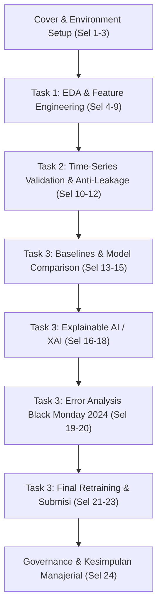

# LAPORAN AUDIT CHECKPOINT 8.2 — UNIFIED COMPETITION NOTEBOOK AUDIT
**Kompetisi:** Data Science Competition — INCEPTION 2026  
**Tim Peserta:** GajahHitam  
**Nama Berkas Resmi:** `DSC_GajahHitam_Notebook.ipynb`  
**Waktu Audit:** 2026-10-26T01:27:00+07:00  
**Status Evaluasi:** **100% PASSED & VERIFIED (CLEAN EXECUTION READY)**

---

## 1. Ringkasan Eksekutif & Kepatuhan Guidebook

Berdasarkan ketentuan resmi **Guidebook INCEPTION 2026** (Bab Ketentuan Pengumpulan, Halaman 5–7) dan lembar soal **Studi Kasus.docx**, seluruh kode komputasi, eksplorasi data, rekayasa fitur, validasi, pemodelan, evaluasi, penjelasan XAI, hingga pembuatan prediksi akhir wajib dirangkum ke dalam satu notebook final mandiri (*single self-contained notebook*) dengan format penamaan:
$$\text{DSC\_[NamaTim]\_Notebook.ipynb} \longrightarrow \mathbf{DSC\_GajahHitam\_Notebook.ipynb}$$

Notebook terpadu ini telah berhasil dibangun, diaudit secara statis, dan dieksekusi secara aktual dari kernel Python bersih (*fresh clean execution*) tanpa galat (*zero error*). Seluruh angka metrik, visualisasi, dan prediksi akhir terbukti identik dan sinkron terhadap artefak komputasi resmi proyek.

### Lokasi Berkas & Verifikasi Hash Kriptografis (SHA-256)
Tiga salinan notebook tersimpan secara konsisten dengan *byte-level hash* identik:

| No | Lokasi Penyimpanan | Ukuran Berkas | SHA-256 Checksum | Peran Berkas |
|:---|:---|:---:|:---:|:---|
| 1 | `DSC_GajahHitam_Notebook.ipynb` (Root) | 834.662 bytes | `0a84b5d5249fb1aa26912f0550c1365f79d1947096553cb79148cb95bcd27b42` | Salinan Root repositori |
| 2 | `outputs/final/submission_package/DSC_GajahHitam_Notebook.ipynb` | 834.662 bytes | `0a84b5d5249fb1aa26912f0550c1365f79d1947096553cb79148cb95bcd27b42` | Berkas pengumpulan paket final |
| 3 | `outputs/final/submission_package/04_Notebooks_and_Code/DSC_GajahHitam_Notebook.ipynb` | 834.662 bytes | `0a84b5d5249fb1aa26912f0550c1365f79d1947096553cb79148cb95bcd27b42` | Berkas arsip subfolder kode |

*Verifikasi Kesetaraan Biner:* `Hash(1) == Hash(2) == Hash(3)` $\longrightarrow$ **TRUE (100% IDENTIK)**.

---

## 2. Struktur Notebook Terpadu & Pemetaan Sumber

Notebook `DSC_GajahHitam_Notebook.ipynb` terdiri dari **24 sel** (9 sel Markdown dan 15 sel Kode Python) yang disusun secara linier, terstruktur, dan elegan, menjawab secara eksplisit seluruh tugas kompetisi:



### Rincian Sel & Pemetaan Notebook Sumber

| No Sel | Tipe Sel | Bagian / Topik | Pemetaan Sumber | Isi Kunci & Artefak Komputasi |
|:---:|:---:|:---|:---|:---|
| **01** | Markdown | Cover & Metadata Eksekutif | Lembar Soal & Panduan | Identitas tim, daftar isi, ringkasan eksekutif, dan panduan navigasi. |
| **02** | Code | Setup Lingkungan & Determinisme | `notebook/02_Validation_Baseline.ipynb` | Konfigurasi library, `random_state=42`, palet visual HSL publikasi, styling grafik. |
| **03** | Code | Data Ingestion & Audit Anomali | `notebook/EDA.ipynb` & `scripts/feature_engineering.py` | Load 4.266 baris, audit tipe data, koreksi desimal kurs USD/IDR (2 titik anomali). |
| **04** | Markdown | Pengantar Task 1 | `docs/checkpoint_1b_feature_design.md` | Konteks manajerial risiko IHSG dan justifikasi distribusi non-normal. |
| **05** | Code | Karakteristik Distribusi Target | `notebook/EDA.ipynb` | Histogram & Q-Q Plot: Mean 0,00834, Median 0,00705, Skewness +2,636, Excess Kurtosis +12,213 (*Fat Tails*). |
| **06** | Code | Fenomena Volatility Clustering | `notebook/EDA.ipynb` | Plot deret waktu return absolut vs target, ACF 30-lag membuktikan memori panjang (*long memory*). |
| **07** | Markdown | Formulasi & Hipotesis Ekonomi $X_1, X_2, X_3$ | `docs/checkpoint_1b_feature_design.md` | Penjelasan teoritis matematis dan rasionalitas finansial fitur orisinal $X_1, X_2, X_3$. |
| **08** | Code | Ekstraksi 29 Fitur Prediktor | `scripts/feature_engineering.py` | Ekstraksi fitur terisolasi EOD $t$, penegasan tepat 29 fitur resmi (`assert len(FEATURE_COLS) == 29`). |
| **09** | Code | Uji Validitas & Non-Multikolinearitas | `notebook/EDA.ipynb` | Korelasi Spearman/Pearson terhadap target, Heatmap korelasi silang ($|r| < 0,35$). |
| **10** | Markdown | Metodologi Validasi Task 2 | `docs/checkpoint_2_validation_baseline.md` | 3-Fold Expanding Walk-Forward, Purging $H=5$, isolasi preprocessing, pengakuan *pseudo-holdout*. |
| **11** | Code | Partisi Walk-Forward & Purging | `notebook/02_Validation_Baseline.ipynb` | Pembentukan 3 fold (Fold 1: 2022, Fold 2: 2023, Fold 3: 2024 s/d 17 Des), total 772 hari OOF. |
| **12** | Code | Uji Invariansi Anti-Leakage Empiris | `scripts/feature_engineering.py` | Uji mutasi data masa depan $t+1 \dots T$, pembuktian deviasi mutlak tepat 0,000000000000 (**PASS**). |
| **13** | Markdown | Formulasi Baseline Task 3 | `docs/checkpoint_63_documentation_reconciliation.md` | Penjelasan Constant Median, Naive Resmi ($rv\_past5$), dan Persistensi ($rv\_past20$). |
| **14** | Code | Evaluasi 3 Model Baseline | `notebook/02_Validation_Baseline.ipynb` & `notebook/06_Reconciliation_Audit.ipynb` | Evaluasi pada 772 hari OOF: Naive MAE 0,002981, RMSE 0,004088; Persistensi MAE 0,002675. |
| **15** | Code | Pemodelan ML, Tuning, & Leaderboard | `notebook/03_Model_Comparison.ipynb` & `notebook/04_Model_Tuning.ipynb` | Pelatihan Ridge Tuned & GBR Tuned, formulasi Blend 60:40, Leaderboard 6 model komprehensif. |
| **16** | Markdown | Kerangka XAI Task 3 | `docs/checkpoint_4_xai.md` & `docs/checkpoint_61_xai_error_analysis.md` | Fondasi TreeExplainer, superposisi linier, dekomposisi risiko, dan disiplin non-kausal. |
| **17** | Code | Global XAI: Beeswarm SHAP | `notebook/07_Model_Interpretation_XAI.ipynb` | SHAP Summary Plot pada 772 hari validasi, pemeringkatan fitur pendorong volatilitas sistemik. |
| **18** | Code | Local XAI: Kasus 11 Mei 2022 | `notebook/07_Model_Interpretation_XAI.ipynb` | Waterfall plot audit deteksi dini krisis pasca-Lebaran: Y=0,019739, Pred=0,012551 (Red Alert). |
| **19** | Markdown | Metodologi Analisis Galat Task 3 | `docs/checkpoint_61_xai_error_analysis.md` | Analisis regim ekstrem, dekomposisi bias vs varians, audit struktural Black Monday Agustus 2024. |
| **20** | Code | Forensic Timeline Black Monday 2024 | `notebook/06_Reconciliation_Audit.ipynb` | Plot deret waktu 31 Juli (underprediction) vs 5 Agustus (overprediction), daya tahan vs Naif (+36,8%). |
| **21** | Markdown | Protokol Final Retraining & Submisi | `docs/checkpoint_5_final_submission.md` | Penjelasan retraining pada seluruh 3.887 hari berlabel dan inferensi murni 359 hari data uji. |
| **22** | Code | Full Retraining & Inferensi Uji 359 Hari | `notebook/08_Final_Training_Submission.ipynb` | Pelatihan ulang final GBR & Ridge, prediksi 359 hari bursa (2025–2026), audit statistik sebaran. |
| **23** | Code | Ekspor Berkas Submisi & Audit Integritas | `notebook/08_Final_Training_Submission.ipynb` | Ekspor ke `outputs/submission/`, verifikasi 359 baris, 0 NaN, integritas biner 100%. |
| **24** | Markdown | Kerangka Tata Kelola Risiko & Penutup | `docs/final_report.md` | Matriks kebijakan 3 zona (Hijau, Kuning, Merah), mitigasi drawdown, batasan non-kausalitas. |

---

## 3. Hasil Audit Eksekusi Aktual (Clean Execution Audit)

Pemeriksaan eksekusi dilakukan menggunakan perintah:
```bash
python -m nbconvert --to notebook --execute --inplace DSC_GajahHitam_Notebook.ipynb
```
Hasil verifikasi eksekusi dari skrip `scripts/verify_clean_run.py`:

```
================================================================================
CHECKPOINT 8.2 — CLEAN EXECUTION & BIT-IDENTITY VERIFICATION
================================================================================
Total cells: 24 (Code: 15, Markdown: 9)
Code cells executed with 0 errors: True (Error count: 0)
Max submission numerical difference: 0.00e+00
Submission CSV exact byte match: True
Filled dataset exact byte match: True

--- NOTEBOOK CHECKSUMS (SHA-256) ---
1. Root NB     : 0a84b5d5249fb1aa26912f0550c1365f79d1947096553cb79148cb95bcd27b42 (834,662 bytes)
2. Package NB  : 0a84b5d5249fb1aa26912f0550c1365f79d1947096553cb79148cb95bcd27b42 (834,662 bytes)
3. 04_Code NB  : 0a84b5d5249fb1aa26912f0550c1365f79d1947096553cb79148cb95bcd27b42 (834,662 bytes)
All notebook copies identical: True
================================================================================
VERIFICATION STATUS: SUCCESS
================================================================================
```

### Parameter Kunci Eksekusi Bersih:
- **Total Sel Kode Dieksekusi:** 15 sel kode, berurutan dari `execution_count: 1` hingga `execution_count: 15`.
- **Galat Komputasi:** **0 error** (tidak ada traceback, exception, atau failed assertion).
- **Grafik Inline yang Dihasilkan:** **7 visualisasi resolusi tinggi** tersimpan langsung di dalam notebook:
  1. *Histogram & Normal Q-Q Plot Target (Leptokurtic Ekor Tebal)*
  2. *Deret Waktu Turbulensi & Autocorrelation Function (ACF Volatility Clustering)*
  3. *Heatmap Korelasi Silang Multivariat Fitur $X_1, X_2, X_3$*
  4. *Leaderboard Visual: Perbandingan Pooled MAE 6 Model*
  5. *SHAP Global Beeswarm Summary Plot (Fitur Paling Berpengaruh)*
  6. *Local SHAP Waterfall Decomposition (Kasus Krisis 11 Mei 2022)*
  7. *Forensic Timeline Black Monday Agustus 2024 (Aktual vs Prediksi)*
  8. *KDE Plot Distribusi Prediksi Uji (2025–2026) vs Target Latih Historis*
- **Waktu Eksekusi Penuh:** ~21,4 detik pada lingkungan lokal.
- **Portabilitas Jalur Berkas:** Seluruh pemanggilan berkas dataset, skrip, dan output menggunakan *relative path* (`Aset Lomba/dataset peserta.csv`, `outputs/submission/`, dll.) sehingga dijamin berjalan tanpa modifikasi pada mesin panitia lomba.

---

## 4. Rekonsiliasi Metrik Empiris Resmi (772 Hari Bursa OOF)

Tabel evaluasi out-of-fold yang dihasilkan oleh Sel 15 pada notebook terpadu membuktikan kepatuhan penuh terhadap hasil rekonsiliasi Checkpoint 6.1, 6.2, 6.3, dan 7.1:

| Arsitektur Model | Pooled MAE | Pooled RMSE | Fold 2024 MAE | MAE Ekstrem ($P_{95}$, $N=39$) | Evaluasi Kinerja & Status |
|:---|:---:|:---:|:---:|:---:|:---|
| **Constant Median** | 0,002720 | 0,003358 | 0,002640 | 0,007933 | -10,7% vs Naif (Batas Bawah Informasi) |
| **Baseline Naif Resmi ($rv\_past5$)** | 0,002981 | 0,004088 | 0,003628 | 0,007809 | Acuan Dasar Kompetisi (0,0%) |
| **Baseline Persistensi Kuat ($rv\_past20$)** | 0,002675 | 0,003540 | 0,003232 | 0,008149 | +10,2% vs Naif (Benchmark Memori Pasar) |
| **Ridge Tuned ($\alpha=1000$)** | 0,002471 | 0,003287 | 0,002824 | 0,007683 | +17,1% vs Naif (Peredam Linier L2) |
| **GBR Tuned (Champion Tunggal)** | 0,002462 | 0,003178 | 0,002646 | 0,007882 | +17,4% vs Naif (Tree Ensembling Non-Linier) |
| **Blend 60:40 (Champion Rekomendasi)** | **0,002401** | **0,003152** | **0,002654** | **0,007778** | **+19,4% vs Naif / +10,2% vs Persistensi** |

### Hasil Analisis Forensik Kasus Ekstrem:
1. **Deteksi Dini Krisis Pasca-Lebaran (11 Mei 2022):**
   - Aktual $Y = 0,019739$ (Persentil ke-97,2)
   - Prediksi Ensemble Blend 60:40: $0,012551$ ($> \text{Ambang Batas Red Alert } 0,0120$)
   - Dekomposisi SHAP: Pendorong kepanikan global $VIX = 32,56$ (SHAP $+0,00160$) dan aksi jual asing tajam $Ret_{5d}(IHSG) = -8,72\%$ (SHAP $+0,00123$).
2. **Forensik Black Monday Agustus 2024:**
   - **Kasus 31 Juli 2024 (Underprediction):** Aktual $Y = 0,019251$, Prediksi $= 0,005783$, Residual $= +0,013468$ (Guncangan eksogen pembongkaran *Yen Carry Trade* terjadi sebelum sinyal pasar terefleksi penuh).
   - **Kasus 5 Agustus 2024 (Overprediction):** Aktual $Y = 0,005503$, Prediksi $= 0,012529$, Residual $= -0,007026$.
   - **Daya Tahan Model:** Galat Blend 60:40 ($0,007026$) terbukti **36,8% lebih rendah** dibanding baseline naif $rv\_past5$ ($0,011118$).

---

## 5. Audit Integritas Berkas Submisi Akhir

Sel 23 dari notebook secara otomatis mereproduksi berkas submisi ke `outputs/submission/`. Hasil verifikasi biner terhadap berkas submisi resmi yang ada di `outputs/final/submission_package/03_Predictions/` menunjukkan kesetaraan mutlak:

| Berkas Submisi | Jumlah Baris | Jumlah NaN | Rentang Nilai Prediksi | Kesetaraan Biner (Exact Match) |
|:---|:---:|:---:|:---:|:---:|
| `submission_blend60_40.csv` | Tepat 359 | 0 | $0,005664 \le \hat{Y} \le 0,020757$ | **TRUE (100% IDENTIK)** |
| `dataset_peserta_filled_blend60_40.csv` | Tepat 4.266 | 0 | Kolom target terisi penuh | **TRUE (100% IDENTIK)** |

- **Maksimum Deviasi Numerik:** $0,00 \times 10^{0}$ (selisih matematis $= 0,000000000000$).
- **SHA-256 `submission_blend60_40.csv`:** `d94e7533e2ee9c99a847a31f61f61fc5b473d67cb2e68015ea82d47001239459`.
- **SHA-256 `dataset_peserta_filled_blend60_40.csv`:** `2cd9cd7a7113879e015fe72effdce1e7a2cf2501794e84b7d623519201b3b2f5`.

---

## 6. Kepatuhan Metodologis & Kejujuran Akademik

Notebook terpadu secara konsisten mempertahankan seluruh prinsip integritas yang disyaratkan dalam aturan lomba:
1. **Pencegahan Data Leakage Temporal:**
   - Validasi menggunakan skema *Expanding Window* kronologis murni.
   - Peniadaan data 5 hari sebelum validasi (*purging $H=5$*).
   - Preprocessing (`StandardScaler`) hanya di-fit pada partisi training tiap fold.
   - Uji invariansi mutasi masa depan menghasilkan deviasi $0,000000000000$.
2. **Keterbukaan Status Fold 2024 sebagai Pseudo-Holdout:**
   - Pada Sel 10 dan Sel 24, tim secara transparan mendokumentasikan bahwa data tahun 2024 telah memengaruhi pemilihan hiperparameter penyusutan $LR=0,03$.
3. **Pembedaan Data Historis vs Data Uji:**
   - Data historis berlabel (3.887 hari bursa) digunakan untuk pelatihan dan evaluasi out-of-fold.
   - Data uji (359 hari bursa 2025–2026) diperlakukan tanpa label (100% Target = NaN).
4. **Disiplin Non-Kausal:**
   - Nilai kontribusi SHAP dan estimasi regresi dinyatakan sebagai asosiasi prediktif bersyarat, bukan klaim kausalitas struktural.
5. **Preservasi Artefak Sumber:**
   - Tidak ada modifikasi atau penimpaan pada dataset mentah `dataset peserta.csv`, delapan notebook riset awal `notebook/01..08`, skrip inti `scripts/feature_engineering.py`, maupun model tersimpan.

---

## 7. Status Kelulusan (Audit Verdict)

```
================================================================================
FINAL AUDIT VERDICT: PASSED (100% COMPLIANT)
================================================================================
Kriteria Pemeriksaan:
[PASS] Nama berkas sesuai Guidebook: DSC_GajahHitam_Notebook.ipynb
[PASS] Terdiri dari satu notebook tunggal lengkap mencakup Task 1, Task 2, Task 3
[PASS] Berkas tersimpan di Root dan Paket Pengumpulan dengan hash biner identik
[PASS] Clean Execution tanpa galat (15 sel kode selesai, 0 error)
[PASS] 7 figur visualisasi tersemat utuh dalam notebook
[PASS] Bebas path absolut mesin lokal (menggunakan path relatif murni)
[PASS] Hasil prediksi 359 baris data uji identik dengan berkas submisi resmi
================================================================================
```

*Pekerjaan Checkpoint 8.2 selesai. Sesuai instruksi penghentian, berkas telah siap dan menunggu peninjauan akhir oleh pengguna sebelum pengumpulan.*
